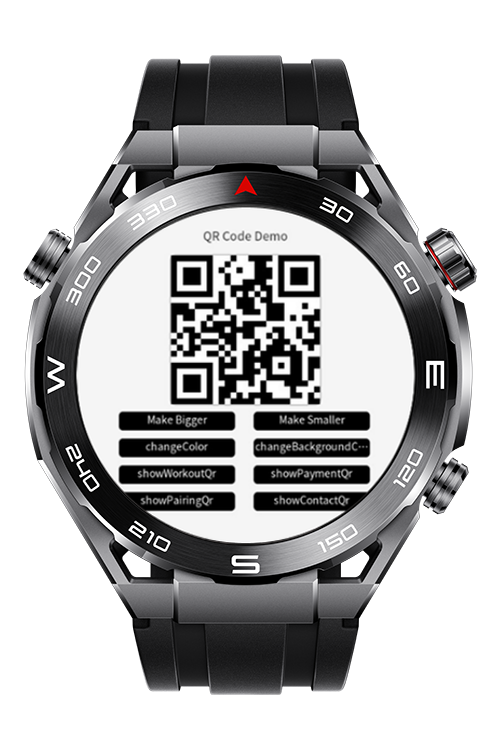
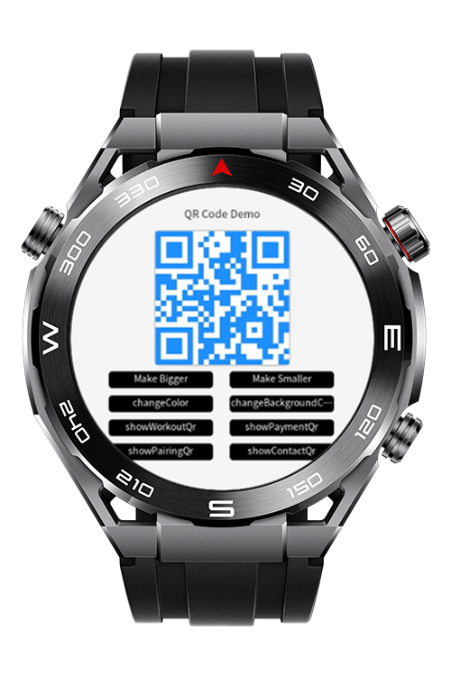
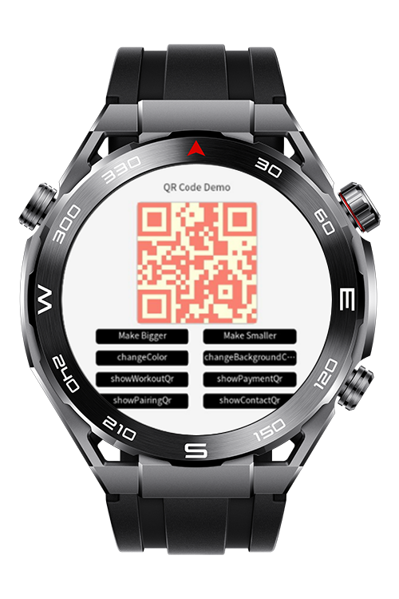

> **Note:** To access all shared projects, get information about environment setup, and view other guides, please visit [Explore-In-HMOS-Wearable Index](https://github.com/Explore-In-HMOS-Wearable/hmos-index).

 # How to Implement and Customize QR Code

This codelab demonstrates how to implement and customize QR Code functionality on Huawei Lite wearable devices.
You’ll learn how to create, display, and dynamically update QR codes directly on a smartwatch using the Huawei Lite Wearable framework.
# Preview
<p align="left">
    
    
    
</p>

# Use Cases
* Generating QR codes on-device
* Changing QR code color and size dynamically
* Updating the content of QR codes (e.g., URLs, contact info, or app data)
* Efficiently rendering the QR code on the low-power, lightweight wearable platform

# Tech Stack
**Languages**: JavaScript (JS), HTML, CSS 
**Frameworks**: HarmonyOS SDK 5.0.0(12)  
**Tools**: DevEco Studio 5.1.0

# Directory Structure
```
entry\src\main\js
├───js
│   └───MainAbility
│       │   app.js
│       │
│       ├───i18n
│       │       en-US.json
│       │       zh-CN.json
│       │
│       └───pages
│           └───index
│                   index.css
│                   index.hml
│                   index.js
│
└───resources
    ├───base
    │   ├───element
    │   │       string.json
    │   │
    │   └───media
    │           icon.png
    │           icon_small.png
    │
    └───rawfile

```

# Constraints and Restrictions

## Supported Device
- Huawei Sport (Lite) Watch GT 4/5/6
- Huawei Sport (Lite) GT4/5 Pro
- Huawei Sport (Lite) Fit 3/4
- Huawei Sport (Lite) D2
- Huawei Sport (Lite) Ultimate

# License

**QR Code Codelab** is distributed under the terms of the **MIT License**.  
See the [LICENSE](LICENSE) file for more information.  